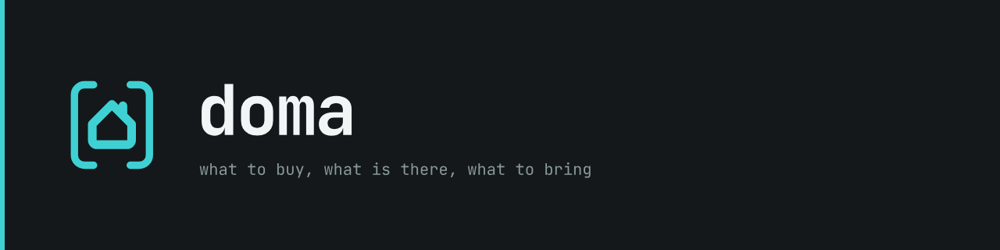

Not released yet. The spec is `docs/design.md`; the brand and UI rules are
`docs/design-system/README.md`; the iPhone and Mac apps are under `app/`. The README in the
siblings' shape is written at the end of phase 0 (see `docs/dev/kickoff.md`).
