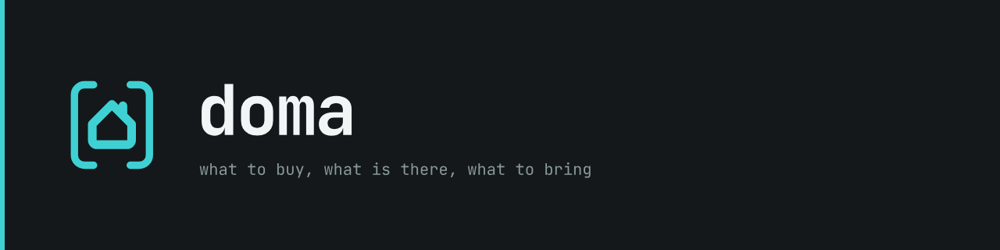
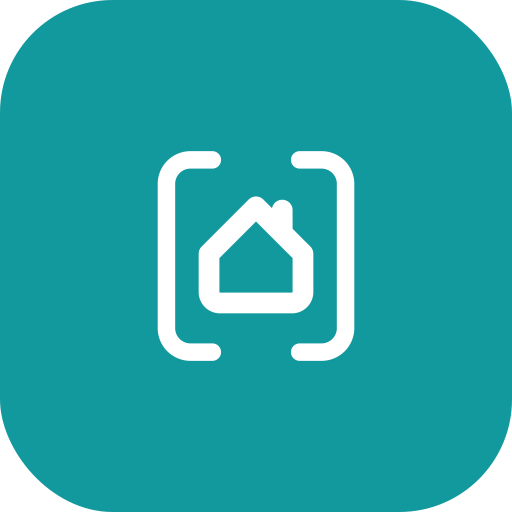

# doma brand assets



## The mark
A terminal bracket holding a small house. The bracket is flok's frame. flok's chevron is a bird
in flight, vink's tick is the bird landed on the line, nt's two lines are a note being written,
each over the cursor; in doma the glyph is a house drawn in line, roof, walls and a chimney, and
it stands alone. doma is the one mark without the cursor: the house is where the prompt went
home to. Thin frame (1.6) as in the siblings on the same 24 grid; the house is one closed path
drawn at 1.9, lighter than the siblings' glyphs because a closed outline at their weight fills
itself in. Only the glyph is doma's; the bracket is unchanged.

The chimney is what makes it a house and not flok's chevron with walls, so it is never dropped,
not even at 16px. The house gets no door and no window; the bracket is the room it stands in.



## The two states
| file | meaning |
| --- | --- |
| `doma-mark.svg` | all is there, or nothing needs you |
| `doma-mark-alert.svg` | something is out at a home you care about: a solid tile with the house knocked out |

At 16–22px only value reads, not detail, so the alert state fills the whole icon. Low is not an
alert and neither is unknown; the next sweep or the next shop settles them. A future menu-bar item
follows flok: a template icon in black and alpha, the solid variant while something is out, and
optionally the two alternating every ~1150 ms until the window gets focus.

## Files
| file | use |
| --- | --- |
| `doma-mark.svg` | mark, `currentColor`: docs, templates, inline |
| `doma-mark-alert.svg` | alert variant, `currentColor` |
| `doma-mark-teal.svg` | W4J teal, for light grounds |
| `doma-mark-cyan.svg` | cyan (`accent` dark), for dark grounds |
| `doma-lockup.svg` | mark + wordmark, horizontal, `currentColor` |
| `doma-lockup-tagline.svg` | lockup + "what to buy, what is there, what to bring" |
| `doma-wordmark.svg` | `[doma]`, the wordmark for places without the mark; the brackets sit 7 units from the ink on both sides |
| `favicon.svg` / `favicon-alert.svg` | 32px tiles: teal with the white mark / `out` red with the white alert mark |
| `doma-tile.svg` | the teal tile at `radius-tile` (22%) with the white mark; source of the avatar and the 512 |
| `doma-appicon.svg` | the Mac and phone app icon: the cyan mark on a dark gradient tile, 1024px, flok's recipe with a heavier frame and house |
| `doma-hero.png` | README banner, 1280×320 |
| `doma-social.png` | GitHub social preview, 1280×640 |
| `doma-avatar.png` / `doma-512.png` | avatar 460px / app icon 512px, from `doma-tile.svg` |
| `app/ios/Doma/Assets.xcassets/AppIcon.appiconset/AppIcon.png` | the app icon at 1024px, flattened, written there by `render.py`; the Mac app draws its icon from `doma-appicon.svg` |
| `gen.py` | writes every SVG and the two render pages from one geometry; text is outlined from JetBrains Mono 700 and 400 |
| `hero.html` / `social.html` | render pages written by `gen.py` |
| `render.py` | renders the five PNGs: Playwright's Chromium for the pages, cairosvg for the tiles |

All wordmark text is converted to outlines, so no font is needed to render the SVGs. `gen.py` is
deterministic: running it again writes the same bytes. It needs `fontTools` and `brotli` (the
fonts are woff2). The render pages load JetBrains Mono from `docs/design-system/fonts`, so
rendering needs no network.

```sh
python3 assets/brand/gen.py
python3 assets/brand/render.py
python3 assets/icons/gen.py
```

## Palette
Dark is the brand's home; light is complete too. `docs/design-system/tokens.json` is the source
of truth; `gen.py` mirrors the values it needs.

| token | dark | light | role |
| --- | --- | --- | --- |
| W4J teal (`brand`) | `#12999D` | `#12999D` | the tie to w4jnl: tiles, favicon, avatar |
| `accent` | `#3FD0D4` | `#0B7A7E` | the one interactive colour; the mark on dark |
| `have` | `#5FC47A` | `#1F7A3A` | flag: it is there |
| `low` | `#E8963C` | `#9A5A0E` | flag: last one open |
| `out` | `#F0645A` | `#C0342B` | flag: not there; also an armed destructive button |
| `ink-muted` | `#8A999C` | `#5A686B` | unknown, quantities, who and when, secondary text |
| `ground` | `#14181A` | `#F6F8F8` | the screen, and flok's terminal background |

`have`, `low` and `out` carry the same values as vink's `up`, `late` and `down` and nt's `ok`,
`warn` and `alert`. Every flag also has a glyph shape (disc, half disc, diamond, dashed ring), so
colour is never the only signal.

## Type
JetBrains Mono 700 for the wordmark and headlines and 400 for the tagline and data, as in the
siblings. In the apps the UI is the system face and mono is for data only. Embed the fonts; never
load them from a CDN.

## ASCII lockup
For `doma serve` on start, the admin Server page and the logs:

```
  ╭─────────╮
  │    ⌂    │   doma 0.1.0
  │         │   what to buy, what is there, what to bring
  ╰─────────╯   w4j.nl

[⌂] doma  ·  2 households  ·  ● 38 have  ◐ 3 low  ◆ 2 out  ◌ 4 unknown
```

The one-line form `[⌂] doma` is the mark: the house alone, as in the SVG. A narrow column uses
`⌈⌂⌉`.

## Clear space
One bracket width (3.9 units on the 24 grid) on all sides. Never place the mark on a background
between `#4A5A5D` and `#A8B4B6`, where the frame loses contrast.

The full system (voice, colour, the app and web rules, the pictograms) is in
[`docs/design-system/README.md`](../../docs/design-system/README.md).
