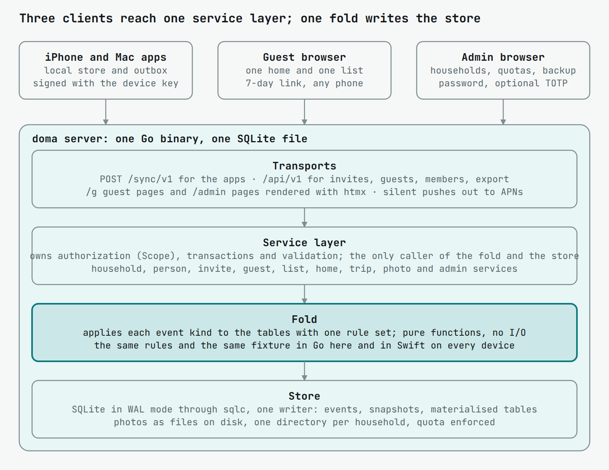
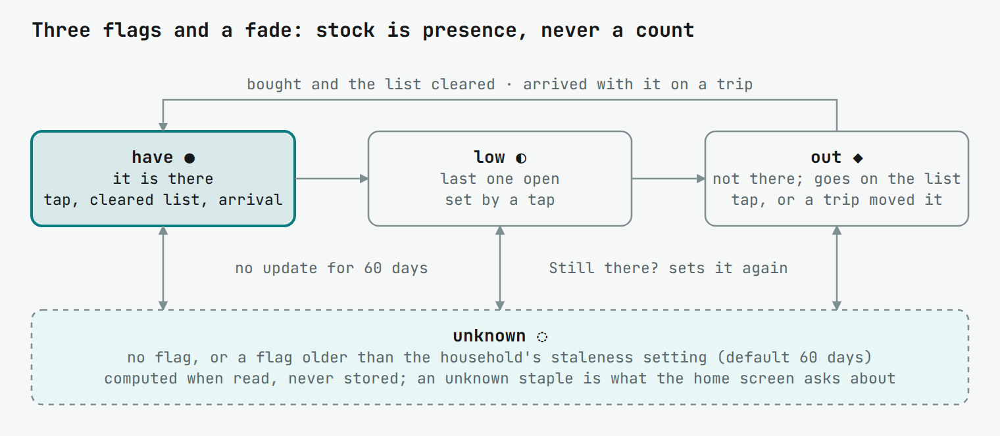
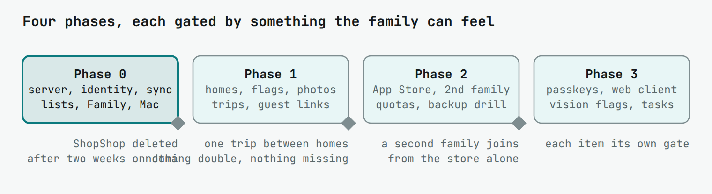

# doma — design

As of 2026-11-01 · J. This file is the source of truth for implementation. Brand and UI rules: `docs/design-system/`; logos and icons: `assets/brand/` and `assets/icons/`.

## Purpose, scope and principles

This document specifies a family household app — shared and personal shopping lists, stock flags across several homes, and trip lists — as one Go server with an event log and native iPhone and Mac clients, in enough detail for an implementing agent to build version 1 without further design decisions. Name: `doma`, Slovak for "at home" (binary, repo `w4jnl/doma`, bundle `nl.w4j.doma`); the App Store listing carries a qualified name, see open decisions. Background: ShopShop is the behavioural baseline for lists; vink (`w4jnl/vink`) is the structural baseline for the server.

**Goals (v1)**

- Shopping lists with ShopShop's mechanics: type, match against everything ever typed, tap to add, tap to strike, clear struck items. Lists are shared by the household or personal to one person.
- Purchase history from day one: every cleared entry is kept with its quantity, unit, who, when and which home it was for, so later versions can show what was bought, how often and how much. The list screen itself never grows.
- Homes with stock flags per item: have / low / out, who set it and when; flags older than a threshold fade to unknown. Spots (drawer, fridge) with one current photo each.
- Trips: pick from-home and to-home; the app derives what to bring and what to buy.
- Households as the tenant boundary; a person can be in several households with a different role in each; guests get a scoped web link.
- Onboarding by QR code: no accounts, no passwords, no URLs typed, no command line for anyone.
- Sync through one append-only event log per household; clients work offline and merge without conflicts.
- Server-rendered web pages for guests and for the instance admin, on the same service layer the API uses.
- No outbound calls from the server except APNs and whatever the admin configures.

**Non-goals (v1)**

- Stock counts, product barcodes, expiry dates, recipes, meal plans (the family's loyalty cards are a phase 4 feature, see Cards). Quantities are kept on purchases (see Shopping lists), never tracked as stock levels.
- Overview and report screens over the purchase history: the data is kept in v1, the screens come in phase 3.
- Tasks and chores (a later list kind, one `kind` column on `lists`; built in phase 3).
- A full web client for members, multiple servers in one app install, passkeys: designed for, built in phase 3.
- Photo recognition by a vision model: a server job on the photos table, built in phase 3 behind `vision.enabled`.
- Android native app; Android members use the web client when it exists, guests use the guest view now.

**House conventions**

| Concern | Choice |
| --- | --- |
| Server language | Go 1.23+, stdlib first, `internal/` packages, no global state, `context.Context` on every I/O path |
| Logging | `log/slog`, JSON by default; `-d` switches to debug level and the colourised text handler (`MatusOllah/slogcolor`); every request log carries `req_id`, `household_id`, `person_id` when known |
| HTTP | `net/http` ServeMux with method patterns, middleware as `func(http.Handler) http.Handler` |
| Database | SQLite via `modernc.org/sqlite`, WAL, one writer; all queries through `sqlc` from `internal/db/queries/*.sql` |
| Migrations | `amacneil/dbmate` as a library, embedded timestamped SQL, applied at startup; `db/schema.sql` dumped for sqlc |
| Web pages | `html/template` + htmx 2.x vendored, one CSS file with design tokens, no build step |
| Config | TOML file + `DOMA_*` env overrides; secrets never logged |
| Errors | `%w` wrapping, sentinel errors per package, RFC 7807 `application/problem+json` on the API |
| Apps | Swift 6, SwiftUI, XcodeGen projects under `app/ios` and `app/macos` over `app/shared`, as nt; GRDB for the local store, no third-party UI |
| Tests | table-driven; server tests on a temp SQLite file, no DB mocks; the fold logic tested against one JSON fixture under `docs/fixtures/`, read by the Go and the Swift tests |

**Principles**

1. Tenancy is structural: every row below `households` carries `household_id`; every sqlc query takes a scope; a CI grep fails a query on a household table without it.
2. One event log, one fold: the server and the apps apply the same events with the same rules; materialised tables are a cache of the log.
3. The family vocabulary is the only vocabulary: home, list, item, member, guest, invite. No tenant, token, event, sync or server on any family-facing screen.
4. Designed wider than built: persons, credentials and `(server, household)` keys exist from migration one so a second server, a web client and passkeys are rows and routes later, never migrations of family data.

## What a family sees: onboarding, roles, vocabulary

A new member goes from App Store to a working shared list in under a minute, with nothing typed: the household owner shows a QR code, the member scans it, the lists appear. Everything below exists to make that true.

**Onboarding**

1. The operator runs `doma serve` once; the first browser visit shows a setup page that creates the admin login (name, password, confirm) and the first household. The page never appears again.
2. The admin, or any owner from the app, creates a household: name, home timezone, first home name. Two fields and a button.
3. An owner taps **Invite** in the app's Family screen and chooses a role (member or owner). The app shows a QR code and a share button for the link. The invite is valid for 7 days and one use; the owner can revoke it from the same screen.
4. The new member installs the app from the App Store. First launch shows one screen: *Scan your family's invite*, with a camera view and a *Paste a link* fallback. Scanning registers the device (a key pair generated on the phone), creates the person on that server if the device is new to it, and adds the membership. A device that already belongs to the household, after a reinstall that kept its key, gets its membership back from any valid invite of that household and the invite stays unused.
5. The member lands on the household's list screen with the shared lists already populated. Personal lists start empty with one line of help.

A guest link is the same flow without an app: the owner picks a home and a list, taps **Guest link**, shares it; the guest opens it in any browser and sees that home's missing items and that list, nothing else. Default validity 7 days, revocable.

An owner who belongs to a second household accepts a second invite the same way; the app adds the household to its switcher. If the second household lives on a different server, the app stores a second server context: the same device key, its own credential and person there, its own households and cursors. The switcher then groups households under each doma's address; a bare invite code goes to the doma of the household in front, and the name is asked once more on the first join to a new doma, filled in with the name used so far. When the last household on a server is left, the context goes with it.

The apps come back where they were left: the household and the screen last in front on that device, and within a household the list last opened. A person who asked for it in Settings gets the lock: the app covers itself and asks Face ID, Touch ID or the passcode (`LocalAuthentication`, kept on the device) on a return after a chosen time away: at once, 30 seconds, 1 minute, 5, 15, an hour, 24 hours, or when the date turns. A second device of the same person, a Mac or a new phone, joins through *Add a device* in Settings: a one-use invite bound to the person, valid a day, shown as a QR. The new device scans it like any invite and gets its own key under the same name and every household the person is in; it never becomes a second member. A device invite is not among the household's pending invites.

**Roles**

| Action | guest | member | owner | admin (server) |
| --- | --- | --- | --- | --- |
| see the linked home's missing items and the linked list; add and strike on that list | ✓ | ✓ | ✓ | |
| all lists, homes, flags, trips of the household; create and edit personal lists | | ✓ | ✓ | |
| create shared lists, homes, spots; set flags; take photos | | ✓ | ✓ | |
| invite members, make guest links, remove a member or a lost device, rename the household | | | ✓ | |
| create households, set quotas, see server pages, back up | | | | ✓ |

Roles are per membership. The same person is owner at home and member at their parents'. There is no per-list permission in v1; a personal list is private to its person by construction.

**Vocabulary** (family-facing strings, used exactly, English first, with Dutch and Slovak strings in the same catalogue)

| Word | Means |
| --- | --- |
| household | the family; the tenant |
| home | a place the household keeps things: Gouda, the cabin |
| spot | a storage place in a home: pantry, fridge door, bathroom cabinet |
| item | a thing you buy or keep; the catalog is the set of items ever typed |
| list | a shopping list, shared or personal |
| card | a shop's loyalty card, the household's or one person's; its barcode is what the till scans |
| flag | have, low, out, unknown — the state of an item at a home |
| trip | from one home to another: a bring list and a buy list |
| member, owner, guest | the three roles |
| invite, guest link | the two ways in |

Words that never appear on a family-facing screen: tenant, token, event, sync, server, credential, instance, device key.

## Architecture and repository layout

One repository, `github.com/w4jnl/doma`, as the siblings: the Go server at the root and the apps under `app/`, in nt's layout (`app/ios`, `app/macos`, `app/shared`). The event schema and the fold fixture live once, under `docs/`, and the Swift tests read them by path; nothing is vendored.



Clients never reach the store: the apps speak the sync protocol, browsers get rendered pages, and every path ends in the service layer, which validates, appends to the log and lets the fold write the tables.

The server has four transports that never touch the database: the sync API used by the apps, the REST API for the web pages and later clients, the guest and admin web pages, and APNs out. All call one service layer that owns authorization, transactions and the fold; the store is generated by sqlc.

**Server repository `doma`**

```
cmd/doma/                 main: serve (the only subcommand), -d, --config
internal/config/          TOML + DOMA_* env, validation, redaction
internal/domain/          Household, Person, Credential, Membership, Home, Spot, Item, List, Entry, Flag, Photo, Event, Scope, Role, ids
internal/db/              open, pragmas, WAL, busy_timeout; generated sqlc code
internal/db/migrations/   YYYYMMDDHHMMSS_name.sql, embedded, dbmate; schema.sql dumped for sqlc
internal/db/queries/      *.sql by table; every query on a household table takes household_id
internal/fold/            the event fold: apply(event, tables) for every kind; pure, no I/O; fixture tests
internal/service/         households.go persons.go invites.go guests.go sync.go lists.go homes.go trips.go photos.go admin.go
internal/auth/            devicekey.go (signature check), session.go (admin), guest.go, scope middleware
internal/http/            server.go router.go middleware/ (reqid, log, recover, csrf, scope)
internal/http/sync/       POST /sync/v1, cursors, snapshot download
internal/http/api/        /api/v1 handlers, problem.go, openapi.yaml
internal/http/web/        guest pages, admin pages, setup page; templates/, static/ (tokens.css, fonts, doma.css, htmx.min.js, the icon sprite)
internal/push/            APNs token auth, device token registry, coalescing
internal/photos/          disk store per household, quota, thumbnails
internal/export/          household → markdown + JSON archive
internal/metrics/         Prometheus collectors
docs/                     event-schema.json, fixtures/fold.json, deploy/ (systemd, compose, traefik)
docs/design-system/       README.md (brand and UI rules), tokens.json (source of truth), tokens.py → tokens.css, fonts/
assets/brand/             marks, lockups, wordmark, tiles, app icon, hero and social; gen.py, render.py
assets/icons/             the pictograms, one SVG each plus the sprite doma-icons.svg; gen.py
```

**Apps, under `app/`** (nt's layout: two XcodeGen projects over one shared tree, `#if os` where the platforms differ)

```
app/ios/                  project.yml (XcodeGen), Doma/ (the iOS target, its Assets.xcassets with AppIcon), DomaTests/, ExportOptions.plist, Local.xcconfig.example
app/macos/                project.yml, Doma/ (the Mac target), DomaTests/
app/shared/               DomaKit, compiled into both targets
app/shared/Store/         GRDB schema mirrored from the server's household tables, keyed by (server_id, household_id)
app/shared/Fold/          Swift port of internal/fold, tested against ../../docs/fixtures/fold.json by path
app/shared/Sync/          outbox, cursor per (server, household), SyncClient (URLSession), background refresh, push handling
app/shared/Identity/      device key in the Secure Enclave or Keychain, server contexts, invite acceptance
app/shared/Model/         value types shared with the UI
app/shared/Views/         Lists, List, Homes, Home, Trip, Family, Scan, Settings
app/shared/Design/        Tokens.swift mirroring tokens.json, glyphs, the custom symbols, Dynamic Type helpers
```

**Conventions inside the tree**

- Handlers are thin: parse, one service call, render. Services own transactions and return domain errors (`ErrNotFound`, `ErrForbidden`, `ErrValidation{Field, Msg}`), never `sql.ErrNoRows`.
- `domain.Scope{HouseholdID, PersonID, Role}` is set once by auth middleware and travels in `context.Context`; every service method takes it first; a guest scope carries `HomeID` and `ListID` and nothing else.
- Ids are ULIDs as text; timestamps are integer Unix milliseconds UTC; the fold uses a hybrid logical clock (`hlc` = `(wall_ms, counter, device_id)`), never device wall time alone.
- The fold package is the only code that writes materialised tables from events, on both sides. The service layer validates and appends; the fold applies. A bug in the fold is fixed once and verified by the shared fixture.
- Templates: one layout, one file per page, partials for htmx swaps; view models built in Go; no external URLs in any template.
- Brand and UI rules are `docs/design-system/README.md`; its `tokens.json` is the source of truth for every colour, glyph and size. The web pages load `tokens.css` and use `dm-*` classes in one hand-written CSS file; the apps mirror the tokens in `app/shared/Design/Tokens.swift` with a test that fails on drift; `make brand` regenerates the marks and pictograms from `assets/brand/gen.py` and `assets/icons/gen.py`. No hex value anywhere else.

## Data model and tenancy

Nineteen tables. Four are instance-level (persons, credentials, households, admin), the rest hang off a household and carry `household_id` on every row. The materialised tables below `events` are a cache: the fold can rebuild them from the log, and a test proves it.

**Identity (instance level)**

| Table | Key columns | Notes |
| --- | --- | --- |
| `persons` | `id`, `display_name`, `created_at`, `last_seen_at` | one per server; no email, no password; the display name comes from the invite acceptance screen |
| `credentials` | `id`, `person_id`, `kind` (`device_key` / `passkey` / `guest_link`), `public_key` or `hash`, `label` ("J's iPhone"), `platform`, `apns_token` (nullable), `created_at`, `last_used_at`, `revoked_at` | a device is a credential; passkeys are a later kind, same table; guest links are credentials of a throwaway person with `kind = guest_link` |
| `households` | `id`, `slug`, `name`, `timezone`, `quota_devices`, `quota_photo_bytes`, `created_at` | quotas null = unlimited; `slug` is used in export paths only, never in URLs a family sees |
| `memberships` | `person_id`, `household_id`, `role` (`owner` / `member` / `guest`), `home_id` (guests only), `list_id` (guests only), `expires_at` (guests only), `created_at` | primary key (`person_id`, `household_id`); a guest membership is what a guest link resolves to |
| `invites` | `id`, `household_id`, `role`, `token_hash`, `created_by`, `expires_at`, `used_by`, `used_at`, `revoked_at`, `for_person_id` (nullable) | one use; the QR encodes `https://<base_url>/i/<token>`; with `for_person_id` set it is a device invite: accepting adds a key to that person instead of a person to the household |
| `admin` | `id`, `login`, `password_hash`, `totp_secret` (nullable), `created_at` | one row; the server pages' login; argon2id |

**Household data**

| Table | Key columns | Notes |
| --- | --- | --- |
| `events` | `seq` (integer, per household, assigned by the server), `id` (ULID from the client), `household_id`, `person_id`, `credential_id`, `hlc`, `kind`, `payload` (JSON), `received_at` | append-only; unique on `id`; indexed on (`household_id`, `seq`) |
| `snapshots` | `household_id`, `seq`, `blob_path`, `created_at` | nightly; a new device downloads the snapshot and then events after its `seq` |
| `homes` | `id`, `household_id`, `name`, `sort`, `archived_at` | |
| `spots` | `id`, `household_id`, `home_id`, `name`, `sort`, `archived_at` | |
| `items` | `id`, `household_id`, `name`, `norm_name` (unique per household), `category` (nullable), `last_used_at`, `use_count`, `archived_at` | the catalog; `norm_name` = lowercased, diacritics stripped, whitespace collapsed; `use_count` drives autocomplete order |
| `item_aliases` | `item_id`, `household_id`, `norm_name` | "olijfolie" and "olive oil" can be the same item; created only by an explicit merge in the UI |
| `lists` | `id`, `household_id`, `name`, `colour`, `owner_person_id` (null = shared), `sort`, `archived_at`, `kind` (`''` shopping, `tasks`) | personal lists have an owner and are filtered by scope; the server never returns another person's personal list |
| `entries` | `id`, `household_id`, `list_id`, `item_id`, `note` ("the small jar"), `qty` (decimal, nullable), `unit` (nullable), `for_home_id` (nullable), `added_hlc`, `added_by`, `checked_hlc` (nullable), `checked_by`, `cleared_hlc` (nullable) | one open entry per (`list_id`, `item_id`) and any number of cleared ones; re-adding an item that is checked but not cleared unchecks it; cleared entries are never deleted or pruned: they are the purchase history |
| `flags` | `household_id`, `home_id`, `item_id`, `state` (`have` / `low` / `out`), `set_hlc`, `set_by`, `note` | primary key (`home_id`, `item_id`); staleness is computed at read time from `set_hlc`, never stored |
| `staples` | `household_id`, `home_id`, `item_id`, `sort`, `section` | the items a home should always have; the trip view and the home view are built from this set; `section` is the name of the group the staple is shown under, empty for none |
| `proposals` | `id`, `household_id`, `home_id`, `item_id`, `state`, `photo_id`, `proposed_hlc`, `closed_hlc` | what the vision model suggested after a photo; open while `closed_hlc` is null; derived by the fold from `flag.proposed` and `proposal.declined` |
| `photos` | `id`, `household_id`, `spot_id`, `taken_hlc`, `taken_by`, `path`, `thumb_path`, `bytes`, `width`, `height` | files under `photos.dir/<household_id>/`; the newest per spot is current; older ones kept until `retention.photos_per_spot` |
| `trips` | `id`, `household_id`, `from_home_id`, `to_home_id`, `date`, `created_by`, `list_id`, `updated_hlc`, `arrived_at`, `cancelled_at` | a planned trip the family shares: from, to, a date and the list it shops on; its bring and buy lists are a view until the person taps *Arrived*, which commits the bring list as flag changes and sets `arrived_at`; a cancelled trip keeps `cancelled_at`; stored so the history shows what moved |
| `cards` | `id`, `household_id`, `name`, `colour`, `owner_person_id` (null = household), `format`, `value`, `domain` (nullable), `logo_id` (nullable), `updated_hlc`, `archived_at` | a loyalty card: `format` is the barcode symbology (`ean13`, `ean8`, `upca`, `upce`, `code128`, `code39`, `code93`, `itf14`, `codabar`, `qr`, `aztec`, `pdf417`, `datamatrix`), `value` what the barcode says; `domain` is the shop's website when known, for the logo; `logo_id` names the logo file the server fetched, under `photos.dir/<household_id>/cards/`; personal cards have an owner and are filtered by scope exactly as personal lists are |
| `push_log` | `household_id`, `credential_id`, `sent_at`, `seq` | coalescing: at most one push per device per 30 s |

**Tenancy rules the agent must enforce in code and tests**

- Every sqlc query on a household table has `WHERE household_id = ?` as its first predicate; CI greps `internal/db/queries` and fails on a `SELECT`, `UPDATE` or `DELETE` on those tables without it.
- Personal lists and personal cards add a second predicate: `AND (owner_person_id IS NULL OR owner_person_id = ?)`. A guest scope adds `AND list_id = ?` on entries and `AND home_id = ?` on flags and staples.
- The sync endpoint filters events the same way before returning them: a member never receives another member's personal-list events; a guest receives only events for its home and list. Filtering is by event `kind` and payload fields the fold indexes, so personal-list events carry `list_id` and `owner_person_id` in the payload, and every card event carries `card_id` and `owner_person_id`.
- Uniqueness is scoped: `items.norm_name` per household, `lists.name` per (household, owner), `homes.name` per household.
- Deleting a household is admin-only and asked twice on its page, members or not; it cascades through `ON DELETE CASCADE`, removes the photo directory and every person left with no household (their devices with them). A member's phone is told nothing: its next sync of that household is refused with 404 and *Leave this household* removes it there, the other households on that doma keep syncing one by one meanwhile.
- Photos are the only data outside SQLite; the quota is checked before the upload is accepted and the usage is recomputed nightly from disk.
- SQLite pragmas at open: `journal_mode=WAL`, `synchronous=NORMAL`, `busy_timeout=5000`, `foreign_keys=ON`; one `*sql.DB` with `MaxOpenConns(1)` for writes and a second read-only pool.

## Event log and sync

Every change a person makes is one event appended to the household's log; the server orders them and every client folds them into the same tables. The data is sets and single-value flags, so the merge rules fit in one table and two phones striking the same list in the same shop never conflict.

**Event shape**

```json
{
  "id": "01JBX…",               "// ULID minted on the client"
  "household_id": "01JBW…",
  "hlc": "1730380000000:0003:dev_8f2a",   "// wall_ms:counter:device, compared lexically after zero-padding"
  "kind": "entry.added",
  "payload": { "list_id": "…", "item_id": "…", "note": "2x", "for_home_id": null }
}
```

The server adds `seq`, `person_id`, `credential_id` and `received_at` on append. A client never sends `seq`. Payloads are validated per kind against `docs/event-schema.json` before append; an invalid event is rejected with 422 and the client drops it from its outbox and logs it.

**Event kinds and merge rules**

| Kind | Payload | Fold rule |
| --- | --- | --- |
| `item.named` | `item_id`, `name` | insert if `norm_name` unknown; if a different `item_id` already owns that `norm_name`, record the new id as an alias of the existing item (so two phones typing "melk" offline converge on one item) |
| `item.renamed` | `item_id`, `name`, `hlc` | last writer wins on `hlc` |
| `item.merged` | `keep_id`, `drop_id` | add alias, repoint entries, flags and staples; idempotent |
| `item.archived` | `item_id` | sets `archived_at` to the stamp: the item is out of sight while typing, in *Recent* and in History, its purchases kept; an `item.named` that resolves to it, or a merge into it, clears `archived_at` again |
| `list.created` / `list.renamed` / `list.archived` | `list_id`, `name`, `colour`, `owner_person_id`, `kind` (create only) | add-wins for create, which also fixes the kind; LWW on name and colour; archive wins over rename |
| `entry.added` | `list_id`, `item_id`, `note`, `qty`, `unit`, `for_home_id` | add-wins among open entries on (`list_id`, `item_id`); if an open entry exists and is checked, clear `checked_hlc` (re-adding unchecks); if only cleared entries exist, a new entry row is created; LWW on `note`, `qty`, `unit` |
| `entry.checked` / `entry.unchecked` | `list_id`, `item_id` | LWW on `hlc` between the two kinds; an `added` newer than `checked` unchecks |
| `entry.cleared` | `list_id`, `before_hlc` | sets `cleared_hlc` on entries checked before `before_hlc`; a cleared entry is a purchase record, never changed or deleted; an `added` newer than `cleared` creates a new entry |
| `entry.removed` | `list_id`, `item_id` | takes the open entry off the list with no record: the row goes and nothing is counted; a remove older than the add that opened the entry has nothing to take, and an `added` newer than `removed` creates a new entry |
| `flag.set` | `home_id`, `item_id`, `state`, `note` | LWW on `hlc`; `state` ∈ have / low / out; `out` also adds the item to the household's default list with `for_home_id = home_id` if no open entry exists (done in the fold so every client agrees) |
| `flag.proposed` | `home_id`, `item_id`, `state`, `photo_id` | the server's, after a photo: a proposal for the member to answer; derived per (home, item) with the key's other events, so any order agrees |
| `proposal.declined` | `proposal_id`, `home_id`, `item_id` | closes the proposal at the decline; a `flag.set` at or after a proposal closes it too, as does a newer proposal for the same item |
| `staple.added` / `staple.removed` | `home_id`, `item_id`, on the add `sort` and `section` | add-wins, remove-wins only if newer than the latest add; the latest add's `sort` and `section` stand, and an add that leaves one out keeps what was there, so an older app's drag does not empty a section |
| `home.created` / `home.renamed` / `home.archived`, `spot.*` | `home_id`, `spot_id`, `name` | as for lists |
| `photo.added` | `photo_id`, `spot_id`, `bytes`, `width`, `height` | append; the blob is uploaded separately by `photo_id`; the fold marks the photo current if its `hlc` is newest for the spot |
| `trip.planned` | `trip_id`, `from_home_id`, `to_home_id`, `date`, `list_id` | the plan the family shares; add-wins for create, LWW on `hlc` for from, to, date, list and planner |
| `trip.cancelled` | `trip_id` | sets `cancelled_at` at the earliest cancel; a cancel that lands before its plan makes the row the plan then fills |
| `trip.arrived` | `trip_id`, `from_home_id`, `to_home_id`, `moved` (list of `item_id`) | for each moved item: `flag.set out` at from-home and `have` at to-home with the trip's `hlc`; one event so a trip is atomic; sets `arrived_at`; a trip nobody planned takes the arrival's homes and wall |
| `card.added` | `card_id`, `name`, `colour`, `owner_person_id`, `format`, `value`, `domain` | add-wins; fixes the owner, as `list.created` does |
| `card.edited` | `card_id`, `owner_person_id`, `name`, `colour`, `format`, `value`, `domain` | LWW on `hlc` for each field |
| `card.archived` | `card_id`, `owner_person_id` | sets `archived_at`; wins over an edit |
| `card.logo` | `card_id`, `owner_person_id`, `logo_id` | the server's, after it fetched the shop's logo: sets `logo_id`, LWW on `hlc`; the file is downloaded separately by `card_id` and `logo_id` |
| `member.removed`, `device.revoked` | `person_id`, `credential_id` | server-originated; clients drop the membership or stop syncing that credential |

Rules that hold for every kind: events are idempotent by `id`; the fold is deterministic given the same ordered events; a client folds its own events optimistically at creation and again when they come back with `seq`, with identical result; an unknown `kind` is stored and skipped by the fold, so an old app survives a new server.

**Endpoint**

`POST /sync/v1` with the device key signature header (see Security). Body: `{"households": [{"id": "…", "since": 4812, "events": [ … outbox … ]}]}`. One request covers every household the device belongs to on that server.

Response: `{"households": [{"id": "…", "accepted": ["01JBX…"], "rejected": [{"id": "…", "reason": "…"}], "events": [ … everything after since, in seq order, with seq … ], "next": 4830, "snapshot": null}]}`. `events` is capped at 500 per household; the client loops while `next` advances. `snapshot` carries a URL when `since` is older than the newest snapshot by more than `sync.replay_limit` events (default 5,000), and the client replaces its tables from the snapshot before continuing.

The server appends and folds in one transaction per household, then publishes `HouseholdChanged{id, seq}` on the in-process bus; the push subsystem coalesces per device.

**Client side**

- Outbox table: `(event_id, household_id, body, created_at, attempts)`. Events are written to the outbox and folded locally in one GRDB transaction, so the UI updates before any network.
- Cursor table: `(server_id, household_id, since)`.
- Triggers: on foreground, after any outbox write (debounced 300 ms), every 5 s while a list screen is visible, on silent push, and on `BGAppRefreshTask` roughly every 15 min in the background.
- Conflicts do not exist at the fold level; the only user-visible merge is two people renaming the same list, which LWW resolves silently.

**Push**

APNs with token-based auth (`.p8` key, key id, team id in config; no gateway setting, see below). On `HouseholdChanged`, one silent push (`content-available: 1`) per device that has a token and has not been pushed in the last 30 s, with `{"server": base_url, "household": id, "seq": n}` so the app pulls the right cursor. Push is a hint: a device that misses it catches up on the next trigger. A push also carries words when it can: the server composes, from the events since the device was last pushed, what other members added to which list or that they cleared it ("Sam added melk and brood" under the list's name, threaded per list), and sends that as an alert with `content-available` still set, the app's soft two-note chime as its sound and, as `badge`, what others added since the device last spoke to the server, for the icon while the app is away; a device whose own person made every change gets the silent push. Once the app runs it counts the badge for itself from its seen marks, after every sync, in the background too. Only `entry.added` and `entry.cleared` speak; checks never do. Words come at most once per device per two minutes and then say everything since the last words (`push_log.spoken_at`, `spoken_seq`); the silent sync push keeps its 30 s. A device chooses what it hears: the lists it mutes and whether a clear is worth a word (`credentials.muted_lists`, `notify_clears`, set with `PUT /api/v1/devices/{credential}/notify`, read back in `/api/v1/me`); the server leaves those out when it composes. Whether the words show is the phone's notification permission, asked once after joining and shown in Settings; the server keeps no preference and the Mac, which polls, gets none. A device says which of Apple's gateways its token belongs to when it registers it (a build from Xcode: sandbox; TestFlight and the App Store: production), stored as `credentials.apns_sandbox`, and the server sends each push to the matching host, so one server serves both.

**Compaction and retention**

A nightly job writes a snapshot per household (the materialised tables as JSON, gzip) and records its `seq`. Events older than the newest snapshot by `retention.events_days` (default 365) are deleted. The export archive always includes the full remaining log. Materialised entries are never pruned: cleared entries are the purchase history and travel in the snapshot.

## Shopping lists

A list is a blank screen with one add control; the item catalog does the rest. The behaviour below is ShopShop's, specified so the family does not notice the switch.

**Add**

- The add bar is pinned at the bottom of the list, above the keyboard when it is up, and never moves. Each keystroke filters the catalog by prefix on any word of `norm_name` or an alias, ordered by `use_count` desc, then `last_used_at` desc; the top 5 matches show as one-tap rows above the bar, the best nearest the bar, each with a muted *last bought 5 days ago* when the history has it. The row nearest the bar is what Return does: the exact item when the typed name exists, the typed line as a new item otherwise. With the field empty and focused, one row of chips shows the household's most used items that are not on the list.
- Tapping a match adds it and clears the field with the keyboard still up, so a run of items is tap, tap, tap. Pressing return adds the typed text as-is: an exact `norm_name` match reuses the item, anything else creates one (`item.named` + `entry.added` in one outbox write).
- A leading or trailing quantity is split off into `qty` and `unit`, any other trailing text into `note`: "melk 2", "2 melk", "2x melk", "500 g gehakt", "1,5 l melk" and "melk (the small jar)" give item *melk* or *gehakt* with qty 2 / 2 / 2 / 500 / 1.5 / none and unit x / x / x / g / l / none. Units recognised: x, ×, st, stuks, pcs, g, kg, ml, cl, l, pak, fles, zak, blik, bos; anything else stays in `note`. The item name is what is matched; qty, unit and note are shown muted after it.
- Adding an item that is already open on the list flashes the existing row instead of duplicating. Adding one that is checked but not cleared unchecks it.
- A swipe left on a row offers *Edit*: the row becomes one field holding the line as it would be typed ("melk 2 (the small jar)"), with a home chip when the household has homes. A changed name renames the item, the quantity, unit and note replace the entry's (for when the shop only had the big pack), a changed home sets `for_home_id`. Long-press is drag to reorder and nothing else. *Merge with…* on a list row is a Mac menu item, not a phone action; on the phone the family merges from History.

**Strike and clear**

- Tapping a row strikes it (`entry.checked`) where it is: the glyph pops, the line draws through, one firm haptic, and the row keeps its place for 2.5 s with *Put back* at its edge so a second tap takes it back; then it sinks below a thin divider, newest struck at the top of that group. A run of taps sinks together after the last. Tapping a struck row restores it the same way, with *Got it* at its edge while it waits. A scroll never strikes. On the phone a tap in the first half second after the list, or doma, came to the front is a pocket or a pickup and strikes nothing; Settings turns that off or makes it one or two seconds.
- The divider says how many are got and carries *Clear*, armed in place (*Really clear?*), which removes the struck rows (`entry.cleared` with the current `hlc`) with a success haptic; it exists only while something is struck. Cleared entries leave the screen but stay in the store as the purchase history, for the catalog's `use_count` and for *Recent* below.
- The swipe that offers *Edit* also offers *Not needed*: the entry leaves the list with no purchase record (`entry.removed`), so an item added by mistake or no longer wanted counts nowhere, not in History, not in *Recent*, not in the catalog's `use_count`. The Mac has it in the row's menu. A struck row is put back first, then removed. Guests cannot remove.
- Checking an entry with `for_home_id` set flags that item `have` at that home when the list is cleared, not when it is checked; a mis-tap in the shop should not move stock. The flag change rides on the same `entry.cleared` fold rule.

**Lists**

- The Lists tab opens into the last-used list, the default shared list the first time, remembered per household on the device. A *Lists* button at the top left opens the overview, one level down, and so does a second tap on the Lists tab. The overview shows the household's lists first, then the person's own (*Just me*), each with its colour dot, name and how many are to get; `+` creates one. Badge on the app icon = what this device has not seen: entries others added to the household's lists (shared and the person's own) after each list was last in front here. Opening a list moves its seen mark to its newest entry, so the badge falls; in the list the rows others added since the last visit carry a small accent dot for that visit, and in the overview a list with unseen entries shows the dot before its count. Seen marks live on the device only; the person's own adds never count.
- Creating a list asks for a name, *Household* or *Just me*, and *Shopping* or *Tasks*; the list takes the first of the six list colours no list wears, changeable in *Rename*. *Share with the family* on a personal list makes a household list of the same name and colour, moves what is still open onto it and archives the personal one with its history: the family sees the list from that moment, not its past. A shared list cannot be made personal: archive it and make a new one.
- A tasks list is a list of things to do with the same mechanics: type, strike, clear, Recent, personal or shared, a guest link. It differs in its words (*to do*, *done*, *last done*), in what comes up while typing (names used on tasks lists, not what the family buys, and the other way round), and in what a clear means: a done task is no purchase, so History, the usual items of a shopping list and the export's purchases leave it out. A tasks list has no homes and a trip cannot shop on it. The overview marks it with the checklist symbol. The kind is set when the list is made and cannot change.
- A long-press or a swipe on a list row offers *Rename*, *Share with the family* on a personal list, and *Archive*, armed in place like every destructive action; the default list offers only *Rename*. An archived list keeps its history and leaves the screen.
- Each household has one default shared list, created with the household, used by `flag.set out` and by guests. It can be renamed, not deleted.
- *Recent* at the bottom of a list, collapsed by default, shows the last 30 cleared items for one-tap re-adding. This replaces ShopShop's habit of leaving struck items as memory.
- Reorder by drag; the order is per list, stored as a `sort` field on the entry, LWW. Default order is by time added, newest at the bottom, so the list reads like the shop walk the family already has.

**History and quantities**

- A purchase is an entry that was checked and then cleared. It keeps item, `qty`, `unit`, `note`, `for_home_id`, who added it, who checked it and both times. Entries are never deleted, never pruned, and never reused: re-adding an item after clearing creates a new entry.
- Quantities are parsed on add as described above and can be corrected with *Bought…* before clearing. Unparsed text stays in `note`, so nothing typed is lost.
- The history surfaces in *Recent* under each list, in the *last bought* hint on autocomplete rows, and on the History screen, one level under the Lists overview: one month at a time, stepped back and forth under the title, opening on the latest month with a purchase, with the month's purchases per item (how many times, the totals of `qty` by `unit`, when last), per home, and who shopped, named as the family knows them. It reads the same cleared rows on the device; no event is made for it, so every phone and the Mac show the same.
- History is also where the family tidies its items. A swipe on an item row (the row's menu on the Mac) offers *Rename*, in the row, and *Merge into…*: the row becomes a field, the catalog's matches for the typed name follow under it as under the add bar, and a tap on one, armed in place since a merge is one way, folds the item into it (`item.merged`). Both fix every month at once, because the history reads the item's current name and a merged item reads through. *Retire*, armed in place, is for an item the family does not want to see again: it leaves autocomplete, the usual items, *Recent* and the History screen (`item.archived`); its purchases stay in the store, the export and the snapshot, and the item comes back with them when someone types its name again in full or merges into it. Owners and members; guests have no History.
- The history is in every export as `purchases.csv` (one row per cleared entry) and in the household snapshot, so pruning old events loses nothing a family can see.

**In the shop**

There is no shop mode: the list screen is always ready for the shop. Rows are 52pt, the add bar is at the bottom, the screen stays awake while a list is in front, and sync runs every 5 s while it is visible. One layout, learnt once.

**Guest view**

The guest's web page shows the one list with the same add, strike and clear, rendered server-side with htmx, polling every 10 s, and nothing else about the household.

## Cards

The family's loyalty cards, so the Bonuskaart is one tap from the list at the till and the household shares one number for one shop. A card is a name, a colour, a barcode and, when the server can fetch it, the shop's logo. Nothing else: no offers, no catalogue, no points, nothing the shop sends. A card is the household's by default or one person's, like a list.

**Cards and Card**

- *Cards* is the second tab, between Lists and Homes, and a section of the Mac's sidebar. It shows one tile per card, the logo or the initials in the card's colour with the name under it, the card last shown first (remembered on the device, like the last-used list); the household's cards and the person's own, never another person's. Every shopping list carries a card glyph in its toolbar that opens Cards, so the till is two taps from the list.
- A tap on a tile shows the *Card*: the barcode large on white in both appearances, the number in digits under it in the data face, the shop's name as the title. While it is in front the screen is at full brightness and stays awake; both are restored when it leaves. The code is drawn by the app, never fetched: Core Image for Code 128, QR, Aztec and PDF417, doma's own encoder in `app/shared/Design/Barcode.swift` for EAN-13, EAN-8, UPC-A, UPC-E, Code 39, Code 93, ITF-14 and Codabar, each tested by drawing a value and reading it back with Vision as the QR test does. A till that will not read a screen gets the digits.
- A swipe on a tile (the row's menu on the Mac) offers *Edit*, *Share with the family* on a personal card, and *Remove*, armed in place. Share makes a household card with the same fields and archives the personal one, as a list is shared, so the owner is fixed at creation and the sync filter stays what it is. An archived card leaves the screen and keeps its events.

**Add a card**

- `+` on Cards opens *Add a card*: the camera at the top, reading every symbology the table above names (the invite scanner keeps to QR), a *Paste* button beside it for a picture on the clipboard, and the number as a field once read or typed, with its format picked for it, changeable. Under it the name, with suggestions from the bundled shop table as it is typed (a tap takes the name and the shop's website), and *Household* or *Just me*. The card takes the first of the six list colours no card wears. One screen, two fields: the one exception to the one-field rule besides Scan.
- *Paste* is the way out of Klarna or any other wallet: a screenshot of each card there, copied in Photos, pasted here, read by Vision; a picture with no barcode says so and the number can be typed.
- The bundled shop table, `app/shared/Resources/shops.json`, is generated by `scripts/shops/gen.py` from OpenStreetMap's Name Suggestion Index (BSD-3-Clause, named in `NOTICE`), filtered to the EU and EFTA countries and the UK: for each chain the name, the website and the countries it trades in. The device's region sorts its own shops first. It is names and websites only; no logo is bundled.

**Logos**

- When `logos.enabled` is on, a server job takes each `card.added` or `card.edited` with a `domain`, asks logo.dev for the shop's logo through its Brand API with `logos.api_key`, decodes and re-encodes what comes back as a PNG of at most 256 px, stores it under `photos.dir/<household_id>/cards/<card_id>-<logo_id>.png` and appends one `card.logo`. A card without a website is looked up by name first, the top result taken; a wrong logo is corrected by typing the website in *Edit*. A failed fetch is logged and left alone until the next edit; the tile keeps its initials. The server sends the shop's website or name, never the card's number or a person's name. Logo files count in the household's photo bytes.
- With the switch off, every card is its initials in its colour, and nothing is fetched. The Community plan at logo.dev is free, needs no card and asks no attribution of a personal project; the README names it anyway.
- The apps download a logo by `GET /cards/v1/{household}/{card_id}/logo/{logo_id}`, signed like a photo, once per `logo_id`, and keep it in the store.

**What cards are not**

- Not on the guest view, not in the web client in this phase, never on an admin page. The Watch app, when it comes, shows them as its second screen.
- Not in Apple Wallet: Wallet draws none of the EAN and UPC codes the supermarkets use, which is why every card app draws its own.
- A card's number is in the log, the export (`cards.csv`, filtered per person like `lists/*.md`) and the snapshot, as every event is, and behind the app's lock with everything else.

## Homes, stock flags and trips

Stock is a presence flag per item per home, never a count. Whoever notices sets it; whoever leaves takes a photo; the trip view turns the two into a bring list and a buy list.



Any tap sets any flag directly; the drawn arrows are the paths the app takes on its own: a cleared list or a trip arrival restores have, a trip departure sets out, and silence fades every flag to unknown until someone answers *Still there?*.

**Flags**

| State | Meaning | Set by |
| --- | --- | --- |
| have | it is there | a tap on the home screen; clearing a list entry marked for this home; arriving with it on a trip |
| low | last one open, running out | a tap |
| out | not there | a tap; a trip that moved it away; also adds it to the default list for this home |
| unknown | no flag, or the flag is older than `staleness` | computed, never stored |

- `staleness` is per household, default 60 days, settable by an owner between 14 and 365 days. The home screen shows the flag with a muted age label ("3 wk") past half the threshold, and as unknown past it.
- Staples define which items a home is expected to have. The home screen lists staples first, in their order, then any other item that has a flag at this home (nothing pins an item to a spot). A staple with an unknown flag is the question the app asks: *Still there?* with have / low / out buttons.
- *Sections* split a home's staples into named groups: Fridge, Pantry, Cleaning, a person's name. A section is nothing but the name its staples carry (`section` on `staple.added`, up to 40 characters): it exists while a staple names it and is gone when the last one leaves, so there is no table, no event of its own and never an empty one to tidy. Staples without a section come first under no header, so a home where nobody made one looks as before; the sections follow in the order of their first staple, each staple by its `sort`. A move is a new `staple.added` with the section and a sort between its new neighbours; renaming a section adds each of its staples again with the new name, renaming it to another section's name joins the two, and removing it adds them again with none. A section has nothing to do with a spot, and nothing else reads it: flags, the out rule, the trip and the pictures' proposals see every staple as before.
- Setting `out` on a staple adds it to the household's default list with `for_home_id` set, so the next shop covers it; clearing that entry flags it `have` again. No other automation.

**Spots and photos**

- A home has spots (pantry, fridge, bathroom). A spot has one current photo and a history of `retention.photos_per_spot` (default 5). The home screen shows the current photo as a thumbnail per spot; tap to view full size with the taken-by and age. Rename and Remove sit on the thumbnail's long-press and in the More menu of the spot's screen, where a person looks for them.
- *Departure sweep*: from the home screen, *Take photos* walks through the spots in order with the camera open and one tap per spot. Two minutes before locking up; nothing else to fill in.
- Photos are uploaded as JPEG, long edge 1600 px, quality 0.8, by the app after the `photo.added` event is accepted; the server stores the original and a 320 px thumbnail; upload retries ride the outbox. A photo is shown as pending until the upload lands.
- Vision-model proposals: when `vision.enabled` is on, a server job takes each photo as it lands, with the names of the home's staples, to the model at `vision.url` (`vision.provider = "openai"`: an OpenAI-compatible chat completions endpoint, self-hosted or not; `"anthropic"`: Claude through the Messages API at `api.anthropic.com` with `vision.api_key`; the operator's choice) and appends one `flag.proposed` per item the model judged with confidence 0.6 or more and differently from the flag as it stands. The home screen shows them under *From the pictures*, each with *Accept*, which sets the flag, and *Keep*, which declines; a flag written by anyone after the proposal closes it as well, and a newer proposal replaces an older one. The model sees the picture and the item names, nothing else; with `vision.enabled = false` nothing in the process can reach it.

**Trips**

- A trip is from-home → to-home on a date, shopping on one shared list (the household's default unless chosen otherwise). The Trip tab lists the upcoming trips by date, nearest first, then the past ones; `+` plans one with two pickers, a date and the list; Edit changes them and Cancel, armed in place, drops it. The plan is shared through the log; its bring and buy lists are a derived view until *Arrived*.
- A to-home's needs show on the nearest upcoming trip to that home and nowhere else; a later trip to the same home shows only what is still missing once the earlier one has arrived. Bring is judged against each trip's own from-home. Chains do not anticipate: B → C sees what B has now and refreshes once A → B has arrived.
- Bring = items that are `out` or `low` at to-home and `have` at from-home. Buy = items that are `out` or `low` at to-home and not `have` at from-home, plus every open entry on the trip's list with `for_home_id = to-home`. Unknown counts as not `have` at from-home and not `out` at to-home; the trip screen lists unknown staples of to-home in a third group, *Check on arrival*.
- Each bring row has a checkbox for packing; each buy row a *Add to list* button that creates an entry with `for_home_id = to-home` on the trip's list, and names the list; a long-press offers the other shared lists for a one-off. *Add all* for the buy group. "On the list" means open on the trip's list for that home; what sits on another list, the regular groceries, is not the trip's business.
- *Arrived* commits one `trip.arrived` event with the packed items; the fold flags them `out` at from-home and `have` at to-home with the trip's `hlc`. Items not packed are left alone. The trip then shows in History with what moved.
- Two members on the same trip see the same derived view; packing checkboxes are local to the device until *Arrived*, by design: the event is the record, not the checkboxes.

## iPhone and Mac apps

One SwiftUI code base under `app/shared`, five tabs on iPhone (Lists, Cards, Homes, Trip, Family) and a sidebar with the same sections on Mac. Every screen reads from the local GRDB store and writes to the outbox; nothing waits on the network.

**Screens**

| Screen | Content | Writes |
| --- | --- | --- |
| Scan (first launch, or Family → Add) | camera, paste-link fallback, display-name field on first join; a browser's sign-in code, scanned or pasted, signs that browser in | registers the device, accepts the invite |
| Lists | opens into the last-used list; the Lists button or a second tab tap leads to the overview: household lists, then personal, colour dot, name, the checklist symbol on a tasks list, how many to get or to do; `+` to create, shopping or tasks | `list.created` |
| History | under the Lists overview, a row at its foot with this month's count: the month stepped back and forth, the month's purchases per item with the times and the totals of `qty` by `unit`, per home, who shopped; reads the entries table; swipe on an item row for Rename, Merge into and Retire | `item.renamed`, `item.merged`, `item.archived` |
| Cards | the second tab; a tile per card, logo or initials in its colour, last shown first; `+` adds one; swipe for Edit, Share with the family, Remove; reached from the card glyph in every shopping list's toolbar | `card.edited`, `card.archived`, `card.added` (share) |
| Card | the barcode large on white, the digits under it, full brightness and the screen awake while in front | |
| Add a card | camera for every symbology, Paste for a picture on the clipboard, the number and its format, the name with suggestions from the bundled shop table, Household or Just me | `card.added` |
| List | open rows, the divider with the got count and Clear, struck rows, Recent; the add bar pinned at the bottom with matches or the usual items above it, and the mic at its end; swipe left for Not needed and Edit, long-press to drag | `item.named`, `entry.*` |
| Homes | one card per home: name, count of out/low/unknown staples, spot thumbnails; `+` makes a home, Rename and Archive on the row (a trip needs a second home and nothing else makes one) | `home.*` |
| Home | *From the pictures* first, when a photo left proposals, each with Accept and Keep; staples with flag buttons in rows as a list's, typed into a bar at the bottom as entries are on a list, Rename, Move to and Remove on a swipe, a long-press is drag to reorder and, past a header, into another section (the `sort` and `section` on `staple.added`); the sections as headers between the rows, each with a `+` that points the bar at it (*Add to Fridge*) until the field is left, and Rename and Remove on a long-press, Remove dissolving the header only; Move to lists the sections, None and New section, which is a field in the row; other flagged items; the spots' pictures below with `+` for a new one, Rename and Remove on a long-press and in the spot's own screen; the trips through the home; *Take photos* | `flag.set`, `flag.proposed` (the server's), `proposal.declined`, `staple.*`, `spot.*`, `photo.added` |
| Trip | the upcoming trips by date, then the past ones; `+` plans one (from, to, date, list); a trip opens into Bring, Buy, Check on arrival and *Arrived*; Edit and Cancel on the row | `trip.planned`, `trip.cancelled`, `entry.added`, `trip.arrived` |
| Family | household name, members with role and last seen, pending invites, guest links, Invite (prominent), Guest link, Settings, Leave; Remove and Revoke behind a swipe, armed in the row; household switcher at the top when the person is in more than one | invites and guests through the REST API, not events |
| Settings | this device's name, notifications (on, or a way to allow them; a switch per shared list and one for clears), the lock with Face ID or Touch ID, the taps ignored after opening (off, half a second, one or two seconds), staleness (owners), the person's devices with Revoke and *Add a device* (a QR the new device scans to join as the same person), About with the lockup, server name and version | REST |

**Interaction rules**

- State is shown by a word and a glyph, never colour alone: have ●, low ◐, out ◆, unknown ◌. One colour set per state, defined once in `Design/`, with a light and a dark variant.
- Every destructive action is a two-step inline confirm (*Remove → Really remove?*); no modals except the camera.
- Optimistic everywhere: the row appears, strikes or moves on tap; a sync failure shows one small offline badge in the toolbar, never an alert.
- Dynamic Type and VoiceOver on every row; the strike is announced as "checked".
- A household switcher appears only when the person has more than one membership; otherwise the household name is a title.
- Nothing about servers is visible unless the app holds more than one context; then the household switcher shows each doma's address as a section heading, and Settings describes the household in front's doma.

**Voice**

- The mic at the end of the add field says an item instead of typing it, on the phone and on the Mac, offline; a home's bar has the same mic and adds staples the same way. A tap listens; each piece the model settles lands in the field as if typed, the words it may still change shown faintly after it, and the matches answer as for typing. A pause (1.5 s with every word settled) adds what was said as return would: the exact item when the name exists, the line as a new item otherwise, without its full stop. One breath can name several items: a short silence between two words (0.35 s, from the model's word timings) is written as a comma, and the line is split by the catalog's names, peeled off longest first ("halfvolle melk eieren" is two, "salt and pepper" one), then by commas and the language's "and" (and, en, a); words before a known name stay with it ("2 kilos of apples"), and what no rule splits is one item. Typed lines are never split. A second tap stops and keeps the words in the field; leaving the list or the app stops it too.
- Language: English, Nederlands and Slovenčina, the app's three, chosen under the mic (held on the phone, right-clicked on the Mac), since speech is not told its language by itself. The code (EN, NL, SK) shows under the mic and the last choice is remembered on the device; until one is made, the device's own language.
- The model is Apple's `SpeechAnalyzer`, on the device: `SpeechTranscriber` where it has the language exactly (`supportedLocales`; English), else `DictationTranscriber`, the keyboard's model (Dutch and Slovak). The system fetches a language's model the first time it is used, as it does for the keyboard; that is the one fetch, by the system, and the app itself still talks to its doma only. Only the words are kept, never the sound.
- Tests: the simulator has no speech models, so `make voice` runs the same `Listener` on the Mac on a sentence in each language spoken by `say`, and `make mac-test` repeats it while that sound is there.

**Local store and identity**

- GRDB with the household tables mirrored, every table keyed by (`server_id`, `household_id`); `server_id` is a local ULID per context, mapped to a base URL and the device's credential id on that server.
- The device key is an Ed25519 pair in the Keychain (Secure Enclave is P-256 only; the server accepts both, prefer Ed25519 on iOS 17+ via CryptoKit). The public key is sent once at invite acceptance; every sync request is signed (see Security).
- Personal lists are stored like shared ones with `owner_person_id`; the UI filters by the context's person id.
- Background: `BGAppRefreshTask` registered for sync; silent pushes trigger a sync with a 25 s budget; photos upload with a background `URLSession`.

**Mac**

The Mac target reuses every screen in a `NavigationSplitView`: sidebar with Lists, Homes, Trip, Family; the list detail in the main pane, its title in the pane and its rows at `content-max`, left-aligned. A click selects a row, the symbol strikes it, a double click or return edits it; the add row is the last row of the open items. *New list* sits at the foot of the sidebar and opens one field there; a right-click on a list offers *Rename*, *Colour*, *Share with the family* on a personal list, and *Archive*, armed in place. Settings is a window (`⌘,`); an invite is a popover. Keyboard, all of it in the menu bar: `⌘N` new list, return adds or edits, space or `⌫` strikes the selected row, `⌘E` edits, `⌘⌫` clears. The Mac can accept an invite by pasting the link or by scanning the QR with Continuity Camera.

**Simplicity budget**

Five tabs, at most one list and one detail per screen, no screen with more than one text field apart from Scan and Add a card. Anything that does not fit is a long-press item or a Settings row, not a new screen.

## Web: guest view, admin pages, later web client

The server renders three page sets with `html/template` and htmx on the same service layer the API uses: the guest view a family shares, the admin pages only the operator sees, and the setup page that appears once.

**Guest view** (`/g/{token}`)

| Route | Content | Live behaviour |
| --- | --- | --- |
| `/g/{token}` | the home's missing items (staples flagged out, low or unknown, with age) and the linked list with add, strike, clear | list body polls every 10 s; a 24 h cookie keeps the guest signed in after the first open |
| `/g/{token}/add` (POST) | adds an entry; the typed text goes through the same item matching as the app | htmx swap of the list |
| expired or revoked | one plain page: *This link is no longer valid* | |

No household name beyond the list's title, no other homes, no members, no photos. The guest's events carry the guest person's id, so the family sees *added by guest (cleaner)* with the label the owner gave the link.

**Admin pages** (`/admin`; the admin signs in with the password, TOTP optional, or through the proxy in front when `admin.auth = "proxy"`, in which case no password admin need exist: `/` goes to the admin pages and `/setup` is gone)

| Page | Content |
| --- | --- |
| `/setup` | first run only: admin login, password, first household; redirects to `/admin` and never renders again |
| `/admin` | households: name, members, devices, photo bytes used, last event; create household |
| `/admin/h/{id}` | members with role and last seen, devices with platform and last sync, pending invites, guest links, quotas, staleness, export, delete (asked twice, members or not) |
| `/admin/server` | base URL and TLS check, APNs key status and last error, backup now, last snapshot time, log level, version |
| `/admin/invite` | create the first owner invite for a household (QR rendered server-side as SVG) so a family can be bootstrapped without any member yet |

Admin pages never read family content: no list entries, no item names, no photos. The operator sees counts and metadata only.

**Web client for members** (`/app`)

Server-rendered htmx pages on the same service layer, for a member at a laptop or on a phone without the app. No offline support; the sync endpoint stays the apps' path. It needed the `credentials` table and the service layer as designed and nothing else in the schema.

| Route | Content |
| --- | --- |
| `/app` | signed in: the household last in front, else the first; not signed in: the sign-in page, a code to scan with the app and *Use a passkey* |
| `/app/v/{code}` | what the code links to, for a camera that read it instead of doma: *Open in doma* (`doma://vouch/<host>#<code>`, which opens Scan on it), or scan again in the app, or paste the link there |
| `/app/h/{household}/lists` | the household's lists and the person's own, with their counts; a new list, shared or *Just me*, shopping or tasks; a switcher in the top bar when the person is in more than one household |
| `/app/h/{household}/l/{list}` | the list: add, strike, *Not needed*, Clear, in the family's words; the rows poll every 10 s like the guest view |
| `/app/h/{household}/homes`, `…/home/{home}` | one row per home with its out, low and unknown counts, and a new home; the home's staples under their sections with Have, Low and Out on the row, a staple typed into a bar, Remove, the other flagged items, the spots with their newest picture, the trips through it; pictures are taken with the phone |
| `/app/h/{household}/trips`, `…/trip/{trip}` | upcoming trips, Plan a trip (from, to, day, list), past trips; a trip's Bring, Buy with *Add to list*, Check on arrival, *Arrived* and *Cancel the trip*, derived as on the phone |
| `/app/h/{household}/family` | the household's members with role and last seen, Remove for owners; Invite with its QR and link shown once; guest links made and revoked; the person's devices and passkeys with Revoke |
| `/app/passkey/…` | the two WebAuthn ceremonies as JSON, driven by `static/passkey.js`, our own file under the page's CSP |

**Signing in.** The first time, the browser shows a code; the member opens Scan on their phone (Family, *Scan a code*, which reads an invite as well, or Paste a link) and the app, signed with its device key, tells the server who sits at the browser (`POST /api/v1/vouch`). The code lives five minutes, once. The browser's session then belongs to the phone's credential, and the lists page offers *Add a passkey*: a discoverable WebAuthn credential, stored in `credentials` as kind `passkey` with the record as its public key and the hash of its id for the lookup, labelled after the browser, revocable from Settings like a phone. From then on *Use a passkey* signs the browser in with a touch, and the session is the passkey's. Sessions are in memory, a month sliding; a restart signs browsers out. The relying party is the host of `server.base_url`, so the family opens the address the server was told.

## HTTP API

Three surfaces on one router: the sync endpoint for the apps, a REST API for everything that is not an event, and the web pages. All JSON errors are RFC 7807; every response carries `X-Request-Id`.

**Authentication**

| Caller | Credential | Scope |
| --- | --- | --- |
| app | device key signature (headers `Doma-Credential`, `Doma-Timestamp`, `Doma-Signature` over method, path, timestamp, body hash) | every household the credential's person is a member of; a request names the household in the path or body |
| guest | token in `/g/{token}` then a cookie | one home and one list |
| member in a browser | session cookie after a passkey, or after the phone vouched for the browser | every household the person is a member of; the household is in the path |
| admin | session cookie after password (+ TOTP) | instance pages only |

**Endpoints**

| Method + path | Purpose |
| --- | --- |
| `POST /sync/v1` | the event exchange (see Event log and sync) |
| `GET /sync/v1/snapshot/{household}/{seq}` | gzip JSON snapshot download |
| `POST /photos/v1/{household}/{photo_id}` | JPEG upload for an accepted `photo.added`; 413 over quota |
| `GET /photos/v1/{household}/{photo_id}[/thumb]` | signed, cacheable 1 h |
| `GET /cards/v1/{household}/{card_id}/logo/{logo_id}` | the shop's logo the server fetched, PNG, signed and cacheable like a photo; 404 for another person's card |
| `POST /i/{token}` | accept an invite: body `{public_key, platform, label, display_name}`; returns `{server, person_id, credential_id, display_name, household, role}`; for a device invite the person's name wins over the typed one; 413 when the household's `quota_devices` has no seat for the devices coming in (a rejoin takes no seat); `GET /i/{token}` renders the App Store page with the deep link |
| `GET /api/v1/me` | person, credentials, memberships with roles, each with the household's name, time zone and staleness (the apps refresh their copy of the household from it) |
| `POST /api/v1/vouch` | the phone names the person at a browser that shows a web sign-in code; body `{token}`; 404 for a code unknown, expired or used |
| `GET` and `POST /api/v1/h/{household}/invites` · `DELETE /api/v1/h/{household}/invites/{id}` | owners; `POST` with `{device: true}` is any member's, for a device of their own, valid a day, not listed among the household's |
| `GET` and `POST /api/v1/h/{household}/guests` · `DELETE …/guests/{id}` | owners; body `{home_id, list_id, label, days}` |
| `GET /api/v1/h/{household}/members` · `DELETE …/members/{person}` · `PUT …/members/{person}/role` | owners; the last owner cannot be removed or demoted |
| `DELETE /api/v1/credentials/{id}` | a person revokes their own device; owners revoke any device in their household |
| `PUT /api/v1/h/{household}` | name, timezone, staleness (owners) |
| `POST /api/v1/devices/{credential}/apns` | register or refresh the APNs token |
| `GET /api/v1/h/{household}/export` | zip: `household.json`, `events.ndjson`, `purchases.csv`, `lists/*.md`, `homes/*.md`, `cards.csv`, `photos/` (members) |
| `GET /healthz` · `GET /readyz` · `GET /metrics` | process up; DB writable and snapshot job alive; Prometheus with a bearer when `metrics.token` is set |
| `GET /api/v1/openapi.yaml` | hand-maintained, tested against the router |

Membership, invites and guests are REST and not events because they change who may read the log; the server is the only authority on them and clients learn of changes through the `member.removed` and `device.revoked` events the server appends.

**Errors and limits**

Codes: 400 malformed, 401 bad signature or expired token, 403 role, 404 for anything outside the caller's households (never 403, so households cannot be enumerated), 409 invite already used, 413 photo over quota or a household with all its devices, 422 event validation, 429 rate limit with `Retry-After`. Limits: 120 sync requests per minute per device, 2,000 events per sync request, 10 photo uploads per minute per device.

## Security checklist

The attack surface is small and named: invite and guest links, the sync signature, photo uploads, and the admin login. Everything else is unreachable without one of those.

- **Device keys.** Ed25519 (or P-256) public key stored in `credentials`; every app request signs `method\npath\ntimestamp\nsha256(body)`; the server rejects timestamps more than 5 min off and replays within the window by a per-credential nonce cache. The private key never leaves the Keychain; a lost phone is revoked from Family or `/admin`, and the next sync from it gets 401 and the app wipes its local store for that server.
- **Invites and guest links.** 32 random bytes, base64url, stored as SHA-256; shown once in a QR or link; single use for invites, time-limited for both; constant-time comparison; 10 failed token lookups per minute per IP, then 429. The App Store deep link carries the token in the fragment, not the query, so it does not land in logs.
- **Personal lists and cards.** Filtered in the sync layer by the fold's index of `owner_person_id` on every list event and by the `owner_person_id` every card event carries, tested by the cross-person suite: two members in one household never see each other's personal entries or cards through sync, REST, logo download or export.
- **Guests.** A guest scope is `(household, home, list)`; the sync filter and every query add those predicates; a guest cannot call `/sync/v1` at all, only the web routes.
- **Photos.** Decoded and re-encoded server-side (JPEG only) to strip metadata and defuse malformed files; served with `Content-Type: image/jpeg`, `X-Content-Type-Options: nosniff`, from a signed URL valid 1 h. Quota is enforced before the body is read (`Content-Length`) and again after.
- **Admin.** argon2id (`t=2, m=64MB, p=1`), session cookie `HttpOnly, Secure, SameSite=Lax`, CSRF double-submit on every form, 5 failed logins per minute per IP, optional TOTP in v1 since it is one screen. Either that or the proxy's sign-in, never both: with `admin.auth = "proxy"` the reverse proxy in front (Authelia) signs the admin in and names them in `Remote-User`, which the server believes only from a peer in `admin.proxy_cidrs` that also sends `admin.proxy_secret` in `X-Auth-Proxy-Secret`, on every request; the password form is then not served. A proxy sign-in may stand in front of the admin pages only, never the family's links or the apps' paths.
- **Passkeys and the web client.** WebAuthn through go-webauthn, the server's one authentication library; discoverable credentials, user verification preferred, no attestation asked; the challenge lives five minutes in memory behind a cookie; the sign count is kept and a clone warning refuses. The browser session is a `HttpOnly, Secure, SameSite=Lax` cookie with CSRF double-submit on every form and htmx request, like the admin's. The vouch code is 256 bits, five minutes, single use, and only a signed device request can redeem it.
- **Headers on every page.** `Content-Security-Policy: default-src 'self'; img-src 'self' data:; style-src 'self'; script-src 'self'`, `Referrer-Policy: same-origin`, `X-Frame-Options: DENY`.
- **Outbound.** The server makes no outbound connection except APNs (`api.push.apple.com`) when `push.enabled` is on and the vision model at `vision.url` when `vision.enabled` is on, and logo.dev when `logos.enabled` is on; with all three off, nothing at all. Each client is built only when its switch is on, each has one dialer a test wires to fail, and the egress gate in CI names the three files. The model is sent the picture and the staples' names, never a name of a person or a home's address; logo.dev is sent a shop's website or name, never a card's number. No update check, no telemetry, no CDN.
- **Secrets at rest.** The APNs `.p8` key and the admin TOTP secret are encrypted with XChaCha20-Poly1305 under `secrets.key_file` (32 bytes, created on first run). Back it up with the database: without it the APNs key must be re-uploaded, nothing else is lost.
- **Cross-tenant suite.** Integration tests create two households and two persons per household plus one guest, and assert 404 across every boundary for sync, REST, photos and export.
- **Supply chain.** `go.sum` verified, `govulncheck` in CI, no cgo, `-trimpath -ldflags "-s -w -buildid="`, SBOM from the release workflow; the apps pin GRDB by version and carry no other dependency.

## Configuration, observability, packaging

**Configuration** (`doma.toml`, every key overridable as `DOMA_SECTION_KEY`; `/admin/server` shows the effective, redacted config)

```toml
[server]
listen = ":8080"
base_url = "https://doma.example.com"   # invite and guest links, APNs payload, signed photo URLs
trusted_proxies = ["10.0.0.0/8"]
[db]
path = "/var/lib/doma/doma.db"
[photos]
dir = "/var/lib/doma/photos"
max_bytes_per_upload = "8MB"
[sync]
max_events_per_response = 500
replay_limit = 5000                     # older cursors get a snapshot first
[push]
enabled = false
key_file = "/var/lib/doma/apns.p8"      # encrypted at rest after first start
key_id = ""
team_id = ""
topic = "nl.w4j.doma"                   # the app's bundle id
sandbox = false
[invites]
default_days = 7
guest_default_days = 7
[retention]
events_days = 365
photos_per_spot = 5
snapshot_hour = 3                       # server local time
[defaults]
staleness_days = 60
[log]
level = "info"
format = "json"
[metrics]
token = ""
[secrets]
key_file = "/var/lib/doma/secret.key"
[vision]
enabled = false            # a vision model looks at new photos and proposes flag changes
provider = "openai"        # openai: a chat completions endpoint; anthropic: Claude's Messages API
url = ""                   # openai: the base, e.g. http://ollama:11434/v1; anthropic: empty means https://api.anthropic.com
model = ""                 # e.g. qwen2.5vl, or claude-opus-5-5
api_key = ""               # env:DOMA_VISION_API_KEY when the endpoint wants one, required for anthropic; redacted on the server page
timeout_seconds = 60
[logos]
enabled = false            # the server fetches a shop's logo for each card from logo.dev
api_key = ""               # env:DOMA_LOGOS_API_KEY, the Brand API's secret key; redacted on the server page
timeout_seconds = 20

[admin]
auth = "password"                       # or "proxy": the reverse proxy in front signs the admin in (Remote-User)
proxy_cidrs = []                        # the proxy's addresses; its headers count from nowhere else
proxy_secret = ""                       # what the proxy adds in X-Auth-Proxy-Secret; env:NAME keeps it out of the file
proxy_logout_url = ""                   # the proxy's logout page, where Sign out goes; empty hides the button
```

**Observability of the server itself**

- `slog` JSON: one line per request (`method path status dur_ms req_id household person`), one per sync batch (`household accepted rejected returned next`), one per push attempt, one per snapshot job, one per photo upload.
- `/metrics`: `doma_households`, `doma_members{household}`, `doma_events_total{household,kind}`, `doma_sync_requests_total{result}`, `doma_sync_duration_seconds`, `doma_push_total{result}`, `doma_photo_bytes{household}`, `doma_snapshot_age_seconds{household}`, `doma_db_write_duration_seconds`, and `doma_build_info{version}`; `docs/deploy/metrics.md` has the scrape config, a dashboard's queries and the alerts worth having, and a test holds the names and labels to this list.
- `/readyz` fails when the writer cannot `BEGIN IMMEDIATE` within 2 s or the snapshot job has not run in 36 h.
- `-d` on `serve` switches to debug and colour, logs every sync request's event ids, every fold rule applied with its before and after state, and every SQL statement slower than 50 ms.

**Packaging**

- Server: `goreleaser` builds `doma_{version}_linux_{amd64,arm64}` and a `FROM scratch` image `ghcr.io/w4jnl/doma` with `/doma` and CA certificates; `docs/deploy/` has `doma.service` (systemd, `DynamicUser=yes`, `StateDirectory=doma`), `compose.yaml` (also what a Portainer stack takes), a Traefik snippet that terminates TLS and forwards everything, and under `docs/deploy/authelia/` a compose stack with Traefik and Authelia. The server authenticates every route itself; the proxy may add its own sign-in in front of the admin pages only (`/`, `/setup`, `/admin`), never in front of the invite and guest links, `/static/`, the API, sync, the photos or the probes, which phones on mobile data and the apps must reach without a browser. With `admin.auth = "password"`, the default, the proxy's sign-in comes before doma's own; with `admin.auth = "proxy"` doma takes the admin from the proxy's `Remote-User` and asks for nothing more.
- Backup = the DB file, the photos directory and `secret.key`; `/admin/server` has *Back up now*, which uses the SQLite online backup API and writes a dated zip next to the DB. Restore = stop doma, `scripts/restore.sh <zip> <empty data directory>` (the three parts back where the server expects them; with the container, unzipped into the empty volume), start doma on that directory; every household, device and photo and the admin's second step come back, and the phones carry on with their keys. `make e2e` drills exactly this against a throwaway server.
- Apps: `make ios-build`, `make mac-build`, `make ios-testflight` as in nt; TestFlight for the family and the second family through phases 0–2, the App Store as the last feature of phase 3 so strangers install from the store. The Mac app ships outside the store as nt's does: `make mac-release` signs it with the Developer ID, notarizes and staples it into a DMG, `scripts/release.sh` puts the DMG on the GitHub release and writes the cask `doma` in w4jnl/homebrew-tap, so `brew install --cask w4jnl/tap/doma` installs it on macOS 26 or later. Bundle id `nl.w4j.doma`; the App Store listing name is a qualified form such as "Doma – lists, homes, trips" because "Doma" alone is taken (see open decisions); the listing opens on the Scan screen and includes a demo household so review can exercise the app without a server.

## Testing, milestones, open decisions

Four phases, each with a gate the family can feel; the implementing agent works the task lists in order and does not start a phase before the previous gate is met.



Phase 0 is the biggest and the only one with a fixed shape; phases 1 and 2 are short; phase 3 is a list of designed-for features taken one at a time, each with its own gate.

**Testing**

- Fold fixture: `docs/fixtures/fold.json` holds ordered event sequences and the expected tables after each, including out-of-order delivery, duplicate ids, two devices naming the same item offline, re-add after clear, and a trip. The Go and Swift fold tests both load it; a change to the fold is a change to the fixture first.
- Server integration: boot on a temp SQLite file; exercise invite acceptance, sync round trips with two devices, the guest view, photo upload and quota, export; the cross-tenant and cross-person suites.
- Property test on the fold: random event sets applied in random orders converge to the same tables.
- App UI tests: add, strike, clear, offline add then sync, accept invite from a QR image; snapshot tests for every screen in light and dark, two Dynamic Type sizes; `make voice`, the three languages through the Listener on the Mac.
- End-to-end smoke: `make e2e` starts the server, creates a household, accepts two invites with a Go test client that implements the device-key signature, adds on one and reads on the other, flips a flag, derives a trip, commits it, and checks the flags moved; then a second household on the same doma, joined with the same key, synced with the first in one request, whose device quota refuses a third device; and the restore drill: a live server backed up from `/admin/server`, stopped, restored with the script on an empty directory, and found whole.
- Load: `cmd/domaload` with 200 devices syncing every 5 s against a laptop; acceptance is p99 sync under 50 ms and no event lost.
- CI: `go vet`, `golangci-lint`, `sqlc diff`, `govulncheck`, tests with `-race`, the household_id grep gate, `xcodebuild test` for DomaKit.

**Phase 0 — server and lists** (gate: the family's shared list runs on doma for two weeks and ShopShop is deleted)

- [ ] Brand kit in the repos as delivered: `docs/design-system/`, `assets/brand/`, `assets/icons/`, `make brand`; `app/shared/Design/Tokens.swift` and its drift test; the custom SF Symbols from the pictogram files
- [ ] Server skeleton: `serve`, config, migrations for every table above, sqlc queries, setup page, admin login
- [ ] Identity: persons, credentials, device-key signature middleware, invites with QR, memberships and roles, scope middleware
- [ ] Fold package with the fixture; events for items, lists, entries with qty and unit parsing and the purchase history; `POST /sync/v1` with cursors and limits
- [ ] Snapshot job, retention, export zip
- [ ] APNs silent push with coalescing; `push.enabled = false` path verified to make zero outbound calls
- [ ] Apps: DomaKit store, Swift fold against the fixture, outbox and sync client, Scan screen, Lists and List screens with every ShopShop behaviour, Family screen with invite and member management, Mac target
- [ ] Admin pages: households, household detail, server
- [ ] Cross-tenant and cross-person suites, e2e smoke, TestFlight build

**Phase 1 — homes and trips** (gate: one trip between two homes with nothing bought twice and nothing missing)

- [x] Homes, spots, staples, flags with staleness; `flag.set out` → default list rule
- [x] Trip derivation on the client, `trip.arrived`, history
- [x] Photos: capture, upload, thumbnails, quota, departure sweep
- [x] Guest links and the guest view
- [x] Home and Trip screens, Dutch and Slovak strings

**Phase 2 — a second family** (gate: a second family joins a second household from TestFlight with no help beyond the QR, on a server that came back from a backup)

- [x] Second household and second server finished: the device quota enforced at invite acceptance, two households in the e2e smoke, a UI test that joins a second household and switches (the contexts, the switcher, the photo quota and the cross-tenant suite are in)
- [x] Backup and restore drill from `/admin/server`
- [x] Metrics, `docs/deploy/` verified with compose, by hand and as a Portainer stack
- [x] Onboarding polish for a stranger: every screen before the first list, in the three languages

**Phase 3 — designed-for features** (each its own gate)

- [x] Passkeys and the member web client: `/app`, signed in by the phone's vouch and then a passkey; Lists, List, Homes, Home, Trip and Family
- [x] Multiple server contexts in the app (pulled forward from phase 3: a test and a production doma on one phone)
- [x] `flag.proposed` from a vision model over new photos, with a confirm screen: `internal/vision` behind `vision.enabled`, the `proposals` table, *From the pictures* on the home screen
- [x] History and overviews: purchases per item, per month and per home, totals of `qty` by `unit`; read from the entries table, no new events
- [x] Tasks as a third list kind: `lists.kind`, set by `list.created`; done instead of got, names kept apart while typing, no homes, no purchases
- [ ] Watch app for lists

**Phase 4 — cards** (gate: the family pays with a card from doma for two weeks and the old wallet app is deleted)

- [ ] Server: the `cards` table, the four card events in the fold and the fixture, the sync filter and the cross-person suite on cards, `cards.csv` in the export, the snapshot
- [ ] Apps: the barcode encoder with its round-trip test, the scanner widened for Add a card, Paste from a picture, the Cards, Card and Add a card screens with the card glyph on lists, the bundled shop table and its generator, snapshots in light and dark
- [ ] Logos: `internal/logos` behind `logos.enabled`, the `card.logo` event, the logo route, the egress gate on the third file
- [ ] Sections for staples: `section` on `staple.added` in both folds and the fixture, the column, the headers with Move to, the drag across them and the `+` on the home screen, the web client's home under the same headers
- [ ] App Store, last: the listing under the qualified name, the demo household for review, submission (gate: a second family installs from the store)

**Open decisions** (defaults the agent takes unless overruled)

| Decision | Default | Alternative |
| --- | --- | --- |
| Name | `doma` (decided) | the App Store name "Doma" is taken by a property app and Doma Home is a smart-home brand, so the listing uses a qualified name; check EUIPO before the listing |
| Local store | GRDB | SwiftData with a custom store; loses SQL-level fold tests |
| Device key algorithm | Ed25519 in Keychain | P-256 in Secure Enclave; server accepts both from day one |
| Push in phase 0 | yes, behind `push.enabled` | polling only until phase 2 |
| Default list per household | one, auto-created, renameable | user chooses the target list on each `out` |
| Autocomplete order | `use_count`, then recency | recency only, as ShopShop |
| Photo size | 1600 px long edge, JPEG 0.8 | originals; 4–8× the storage |
| Second server in one app | supported (decided 2026-11-04): a second context, the switcher grouped by doma, no picker on Scan since a link names its doma and a bare code goes to the household in front's | refused with a message, as the first builds did |
| Admin TOTP | in v1 | phase 2 |
| Licence and repo visibility | public, MIT, as vink (opened 2026-11-03) | private until the public install |
| Passkeys | go-webauthn/webauthn, the one authentication library, pinned (decided 2026-11-07) | a hand-written verifier for ES256 and none attestation; fewer modules, more to get wrong |
| Logo source | logo.dev through its Brand API, behind `logos.enabled`, off by default, fetched and stored by the server once per card change (decided 2026-11-08): free Community plan, storing what the API returns is allowed, no attribution asked of a personal project | Brandfetch is free and larger but permits embedding only, no fetching or caching, which only the phone could do and the phone calls nothing but doma; the shop's own site icon, blocked by a third of the EU retailers probed; a bundled logo set, a trademark and licence question per file |
| Moving a card into doma | a screenshot of the card in the old wallet, copied in Photos and pasted on Add a card, read by Vision; no new modal | a photo picker, a third modal beside the camera and the share sheet |
| Vision model | an endpoint the operator names, behind `vision.enabled`, off by default: an OpenAI-compatible one, self-hosted (Ollama, LM Studio, vLLM) or hosted, or Claude through Anthropic's Messages API with `vision.provider = "anthropic"` (decided 2026-11-07) | a model on the phone; no server job, weaker models, every phone its own |
